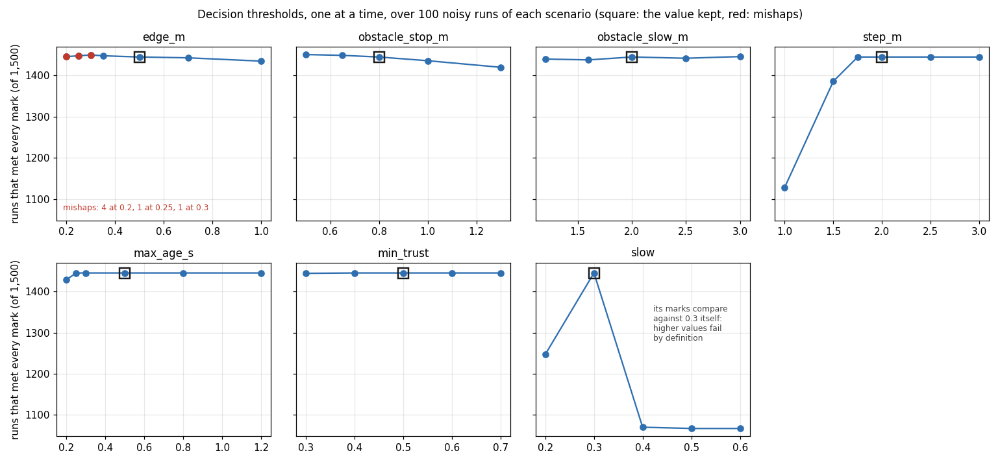

# Design decisions

Each decision records what we chose, what else we looked at, and why. A decision can be revisited; when it is, the old entry stays and a new one says what changed.

## D1. Lidar localisation indoors (#43)

**Proposed, to be confirmed in Gazebo (#13, #14):** slam_toolbox. Map a building once with its mapping mode, then run its localisation mode against the saved map. Its pose is the `LIDAR_MAP` position source.

MANA needs to know where the user is inside a building when GPS is gone, so a helper can be told where to come. That needs a position **on a map of the building**. A track of how far the device has moved since it came in drifts and does not name a place.

| Option | What it gives | Sensor | On ROS 2 Jazzy as a package | Fit for "where in the building" |
|---|---|---|---|---|
| FAST-LIO2 | Lidar-inertial odometry, with a local map built as it goes | 3D lidar and a time-synchronised IMU | No: built from source | Odometry only: no saved map to localise against, so it drifts |
| KISS-ICP | Lidar odometry from point clouds, no IMU needed | 3D lidar point clouds | No: its ROS 2 wrapper is built from source | Odometry only, as above |
| slam_toolbox | Mapping, and localisation against a saved map | 2D lidar scan | Yes, `ros-jazzy-slam-toolbox` 2.8.5 | Yes: the pose is on the building's map |
| AMCL (Nav2) | Localisation against a saved map | 2D lidar scan | Yes, `ros-jazzy-nav2-amcl` 1.3.13 | Yes, but it needs a map made by another tool |

How the package column was checked, with `apt-cache policy` on Ubuntu 24.04, against the ROS 2 package lists of 6 October 2026:

```
ros-jazzy-kiss-icp: no package
ros-jazzy-fast-lio: no package
ros-jazzy-slam-toolbox: 2.8.5-1noble.20260915.204151
ros-jazzy-pointcloud-to-laserscan: 2.0.2-3noble.20260920.234619
ros-jazzy-nav2-amcl: 1.3.13-1noble.20260921.024928
ros-jazzy-robot-localization: 3.8.3-1noble.20260915.182602
```

KISS-ICP and FAST-LIO2 have no package. Other lidar odometry does: `ros-jazzy-rko-lio` (lidar-inertial odometry) and `ros-jazzy-mp2p-icp` (an ICP library). They are odometry too, so the point below applies to them as well.

Why slam_toolbox:
- it gives a position on a saved map;
- it both makes the map and localises against it, so one tool covers both steps;
- it installs as a package, so CI and every member's machine get the same version through rosdep.

What slam_toolbox needs, like AMCL:
- **A starting pose on the map** (`map_start_pose`, or the dock where the map was started).
- **A 2D scan.** With a 3D lidar, `pointcloud_to_laserscan` (`ros-jazzy-pointcloud-to-laserscan` 2.0.2) cuts a horizontal slice. A slice taken in the device's frame tilts on the same ramps and stairs that keep `two_d_mode` off in D2, so on a slope the scan meets the floor or the ceiling. The slice should be cut level, in a frame that follows the IMU's roll and pitch, or kept short of the floor. This is to be checked in Gazebo.

FAST-LIO2 and KISS-ICP are odometry. Either could later feed the EKF below as a better motion source than the wheels on stairs, but neither answers the question MANA has to answer indoors.

What would change this:
- the Gazebo lidar is 3D and its scans are poor for 2D mapping;
- slam_toolbox's position error against Gazebo ground truth is too large for a helper to find the user. This is measured in #43.

## D2. Fusing IMU, wheel encoders and GPS (#43)

**Chosen:** robot_localization, as in its own documentation, with two EKFs and navsat_transform (`src/mana_position/config/localisation.yaml`, `launch/localisation.launch.py`).

- **`ekf_local`** fuses the wheel odometry and the IMU in the `odom` frame. It is smooth and drifts, and it is the `ODOMETRY` source (`odometry/local`).
- **`navsat_transform`** turns GPS fixes into positions in the `map` frame (`odometry/gps`).
- **`ekf_global`** also fuses `odometry/gps` in the `map` frame (`odometry/global`), and publishes the `map` to `odom` transform.
- **`two_d_mode` is off**, because the device tilts on ramps and stairs, and the tilt is what the core reads. In 3D every axis must be measured, or its variance grows without bound, so the wheels also give `vz = 0` in the device's own frame, which stays true on a ramp.
- **One absolute heading per filter:** the IMU's yaw. navsat_transform takes its heading from the IMU too (`use_odometry_yaw: false`), because the wheels give only turning speed, not a heading referenced to the earth. Gazebo's IMU gives yaw in the world frame; a real device needs a magnetometer-backed IMU, or another source of heading.
- **`ekf_global` owns the `map` to `odom` transform.** slam_toolbox also publishes one by default, so it runs with `transform_publish_period: 0.0` (off). Its pose goes to the position node on `lidar/pose`, and later into `ekf_global` as a pose input.
- **`use_sim_time`** is a launch argument for every node, so in Gazebo the filters and the position node's freshness checks use the simulation clock.

The topic names are launch arguments, so they can be remapped to the Gazebo bridge (#14) without editing the files.

## D3. What a driver may still do after MANA stops the chair (#76)

**Chosen:** after a stop, no forward motion at all, but the driver may turn on the spot and reverse at up to 0.3 m/s. Turning is capped at 1.0 rad/s at any time, and nothing moves while the slides change between wheels and tracks.

MANA stops the chair for a user's STOP, for a drop or stairs down at the edge, for an obstacle close ahead, and while it asks about stairs down. In each case the hazard, or what the user stopped for, is ahead. Forward is what must not happen, so the drive request's stop caps forward speed at zero for every driver: the supervisor (#77) and the autopilot (#78).

| Option | After a stop | Problem |
|---|---|---|
| Nothing moves | The chair is held still until the stop clears | The stop clears only when the hazard leaves the sensors' view, and the chair cannot leave it: it is stuck at a drop edge or in front of an obstacle |
| **Turn or reverse slowly** | The driver can move away from what is ahead | Turning swings the chair's ends (on tracks the front is 1.1 m from the centre), and nothing senses what is behind |
| Anything below the speed limit | A stop only slows the chair | A stop that does not stop is not a stop |

Why reversing is slow: the chair has no sensor that looks backwards, so a slow reverse leaves the driver time to see what is behind. Turning on the spot near a drop is the open risk; the open test world (#79) and the scored drives (#81) will show whether it needs a rule of its own, such as no turning within `edge_m`.

## D4. A step that only one sensor sees (#103)

**Chosen:** a step up or a curb measured within `edge_m` by one trusted sensor, with no second sensor to confirm it, stops the chair ("Step ahead, stopping"). The stop holds in manual mode too, unless the user has chosen tracks, which is how they cross it on purpose. It does not stop a chair already on tracks. A report without a distance, such as the camera alone seeing a picture of stairs, still only slows down.

The design has two rules: a change of mode needs two independent sensors, and a stop needs none. Before this, a step seen by one sensor only slowed the chair down. In the dark, where the camera cannot be trusted, the 3D camera alone saw the stairs and the curb, and MANA drove onto both on wheels (found while writing the coverage table, #82).

| Option | One-sensor step at the edge | Problem |
|---|---|---|
| Slow down only (before) | The chair rolls onto it on wheels | A mishap whenever the second sensor is lost |
| Change to tracks | It crosses | One sensor would change the mode: the picture of stairs shows why that is not allowed |
| **Stop, and let the user choose tracks** | It waits; the user crosses on purpose | The user has to act; in the dark that is the safe default |


## D5. How long a stop holds (#97)

**Chosen:** a stop for a drop, an obstacle, a lone step or the stairs-down question holds for `hold_s` (0.5 s) after its hazard was last seen. While it holds, a hazard up to `release_m` (0.1 m) past its limit still counts, so it is released only once the hazard is clearly further away (hysteresis). Choosing tracks to cross a step, a yes, and the user's own go are checked every tick and never held. After the clock goes back (a world reset, a bag played again) nothing seen before counts. A yes heard up to `answer_s` (2 s) after the stairs-down question was last asked still answers it, since one reading can end the question a moment before the user's yes is heard.

Before this, each tick decided from the latest reports alone. In the noisy runs of #54, one distance reading just past `edge_m` or `obstacle_stop_m`, or one lost camera report at the stairs-down question, released the stop for a tick, and it happened again and again while the chair waited.

| Option | After a stop within the limit, 200 noisy runs each | Problem |
|---|---|---|
| Latest reports only (before) | the chair moved on in 196 drop, 167 manual-mode drop and 197 dark-corridor runs, by up to 0.24 m | One reading releases a stop; a yes heard on such a tick is lost |
| Hold for `hold_s` only | moved on in 4 drop, 0 manual-mode and 19 dark-corridor runs, by up to 0.07 m | Readings that sit just past the limit still release it once `hold_s` has passed |
| **Hold, and `release_m` past the limit** | 0 of 200 in all three | A hazard that really is gone is waited for 0.5 s more |

Why 0.5 s: it is as long as a report counts (`max_age_s`), so a stop never holds on a hazard older than any report the core would still use. Why 0.1 m: the noise assumed in #54 is 0.02 m plus 5 % of the distance, about 0.04 m at the drop's 0.5 m and 0.06 m at the obstacle's 0.8 m, so a reading past 0.1 m is rare while the hazard is still at the limit.

## D6. Stop distances from the front of the device (#96)

**Chosen:** the reports keep giving distances from their own sensor. The core turns them into distances from the device's front, for the current mode, from a `Mount`: where the front is on wheels and on tracks, and where each sensor is, all ahead of one point of the device. `edge_m` and `obstacle_stop_m` then hold from the front. While the slides change mode (2.5 s), the longer front counts. With all values at 0, the default, the distances are used as reported, as the scripted world's already are. The simulated chair's values are in `src/mana_sim/config/core.yaml`: front 0.47 m ahead of the centre on wheels and 1.1 m on tracks, the cameras 0.35 m and the lidar 0.4 m.

The device also moves on after a stop is decided: through the reaction (from a sensor frame to the wheels braking), then while it brakes. In Gazebo, with the distances from the front alone, the front stopped 0.34 to 0.35 m before the edge on wheels and 0.015 to 0.15 m on tracks. So `edge_m` and `obstacle_stop_m` (and the lone step's edge) are widened by that travel: `v × reaction_s + v² / (2 × decel_mps2)`, with `v` the speed limit of the last decision that was not a stop, times `top_mps`. The last moving speed counts, not the current one, because the speed limit is 0 while stopped, and the stop would release. A slowed device gets a shorter allowance than one at full speed. The allowance assumes the device already moves at the last speed limit. When the core has only just slowed it down, the device is still faster than that for the reaction and the braking. In a small simulation of the chair (1.2 m/s, 0.5 s reaction, 3 m/s², 10 Hz ticks) that left it 1 to 3 cm inside the drop and obstacle limits. In the Gazebo runs below there was more room. A measured speed (wheel odometry) would close the gap. All three values are 0 by default (no allowance). The simulated chair uses the host's top speed (1.2 m/s), the drive plugin's braking (3 m/s²) and a reaction of 0.5 s. A ground report comes every 0.2 s of simulation time, the core ticks every 0.1 s and the host every 0.05 s. With 0.4 s, one of 11 drop runs on wheels stopped 0.497 m before the edge. At full speed, 0.5 s adds 0.84 m; at the slow-down speed (0.3), 0.20 m.

| Gazebo drop runs (front to the edge, standing still) | Wheels | Tracks |
|---|---|---|
| Distances from the sensors (before) | 0.24 to 0.28 m | past the edge by 0.57 to 0.71 m |
| From the front | 0.34 to 0.35 m | 0.015 to 0.15 m |
| **From the front, with the travel (reaction 0.5 s), 10 runs each** | 0.53 to 0.61 m | 0.85 to 0.98 m |

| Option | Who knows what | Problem |
|---|---|---|
| Each sensor node subtracts the front | The node knows its own mount | It does not know the mode, and the front on tracks is 0.63 m further ahead than on wheels. Every node would need the mode |
| **The core subtracts it** | The core knows the mode, and gets each mount as a parameter | The mounts are set in one more place, the core's parameters. A test keeps the simulation's in step with the model |
| Keep the distances from the sensors | No one | On tracks the front is 0.75 m ahead of the 3D camera, so a stop at 0.5 m from the camera leaves the front past the edge |

A hazard the front has already reached reads 0 m, the worst case. An unknown distance stays unknown. The directions the user hears count from the front too, since they read the same reports.

## D7. Manual mode when the user's input or the ground sensors go (#85)

**Chosen:**
- **The user's input stops.** The user's commands (stop, go, mode, speed) are single events, not a stream, so silence is not a command. MANA keeps manual mode and the speed the user chose. Its stops still apply. The host stands the chair still when the driver's own stream (`cmd_vel`) goes quiet for `watchdog_s` (D3).
- **Every ground sensor is gone.** MANA slows down to `slow` in manual mode too, on the undercarriage the user chose, with the same message as in automatic mode. Before, manual mode came first in the tree and kept the user's speed, with nothing able to see a drop.

| Option | Problem |
|---|---|
| Leave manual mode when the user is silent | A user who drives on without speaking would be taken out of manual mode. That is not their choice, and nothing is unsafe in silence while MANA's stops apply |
| Keep the user's speed with no ground sensor | A drop can no longer be seen, so no stop can come in time at full speed |
| **Slow down, keep the user's undercarriage** | The user drives slower until a ground sensor is back |
| Stop until a ground sensor is back | A dead camera would leave the user stuck where they are. Automatic mode slows down for this, it does not stop |

## D8. The decision thresholds, from a sweep (#86)

**Chosen:** the thresholds stay as they are: `edge_m` 0.5 m, `obstacle_stop_m` 0.8 m, `obstacle_slow_m` 2.0 m, `step_m` 2.0 m, `max_age_s` 0.5 s, `min_trust` 0.5 and `slow` 0.3. Each was swept with `tools/sweep_thresholds.py`, which moves one threshold at a time and keeps every other at its default. Each value plays all 15 scripted scenarios of the time 100 times, on #54's noisy runs, with the same seeds for every value (seed 1). `glare` and `person_leaves` were added after the sweep, so a run now plays 17 and gives other totals. The sweep gives a lower bound for most of them, and each value sits above that bound with a margin. The stop distances also have to fit the chair's real stopping distance, which the scripted world does not have: it brakes at once.

```bash
python3 tools/sweep_thresholds.py --runs 100            # all seven
python3 tools/sweep_thresholds.py --runs 100 step_m     # one of them
```

Why each value:

- **`edge_m` 0.5 m.** At 0.3 m and below there are mishaps even with instant braking: 1 at 0.3 m and 0.25 m, 4 at 0.2 m. From 0.35 m there are none. 0.5 m keeps 0.15 m above that. On a device, the travel after a stop is added on top (D6). Larger values pass a few fewer runs: 1,435 at 1.0 m, against 1,445.
- **`obstacle_stop_m` 0.8 m.** In the scripted world a smaller value always passes more (1,451 at 0.5 m, 1,420 at 1.3 m), because the chair stands still the moment it stops. So this value is set by the stopping distance instead. An obstacle that appears 1.2 m ahead of a chair at top speed is stopped for, with 0.36 m or more to spare, only from 1.5 m/s² of braking (#84). 0.8 m, with D6's allowance, is kept until the real chair's braking is measured.
- **`obstacle_slow_m` 2.0 m.** Nothing from 1.2 to 3.0 m changes the results by more than 8 runs in 1,500, so the slow-down starts where #84's stopping model assumes it does.
- **`step_m` 2.0 m.** Below 1.75 m the chair changes to tracks too late for the marks: 1,386 runs at 1.5 m and 1,128 at 1.0 m pass. From 1.75 m all values pass the same 1,445. 2.0 m keeps 0.25 m above that and 0.5 m above where it drops, and a larger value only adds 0.1 s to the mean time per 0.5 m.
- **`max_age_s` 0.5 s.** 0.2 s passes fewer runs (1,429), and from 0.25 s nothing changes. The scripted hazards do not move, so an older report costs nothing here. On a moving device, a report 0.5 s old is 0.6 m behind at top speed. A report's age is part of the reaction that D6's allowance covers (0.5 s in the simulation). So 0.5 s is not raised.
- **`min_trust` 0.5.** No value from 0.3 to 0.7 changes the results by more than one run. The noise moves trust by only 0.05 around 0.9, and the dark scenarios send the camera's trust at 0.2, below every value swept. So the sweep cannot place it. The trust the models send has to be calibrated first (#87). This works both ways. In `glare`, MANA drives on past a drop that only the 3D camera sees, at trust 0.3, because that drop is false. A real drop reported the same way would be driven past too. The rule is right only while a model's trust means what it says, which is what #87 has to show.
- **`slow` 0.3.** The sweep cannot judge it: the "Slower on the ..." marks compare against the default 0.3 itself, so any higher value fails by definition (1,067 to 1,070 runs). 0.2 makes the chair slower (24.4 s mean time against 20.7 s), and fewer runs pass (1,247). #84's stopping model takes 0.36 m/s (0.3 of 1.2 m/s) as the speed near a hazard.

In every table, the default row passes 1,445 of 1,500 runs: the defaults fail a mark in 55 noisy runs. #54's table in `docs/results.md` shows which scenarios fail under noise. "level: s slowed" is the mean time not at full speed in `level`, where nothing is in the way. It is 0.02 s for every value, so no threshold makes the chair slow down for nothing.

| `edge_m` | runs that met every mark | mishaps | level: s slowed | mean time |
|---|---|---|---|---|
| 0.2 | 1446 of 1500 | 4 | 0.02 | 20.6 s |
| 0.25 | 1448 of 1500 | 1 | 0.02 | 20.6 s |
| 0.3 | 1450 of 1500 | 1 | 0.02 | 20.6 s |
| 0.35 | 1448 of 1500 | 0 | 0.02 | 20.7 s |
| **0.5** (now) | 1445 of 1500 | 0 | 0.02 | 20.7 s |
| 0.7 | 1443 of 1500 | 0 | 0.02 | 20.7 s |
| 1.0 | 1435 of 1500 | 0 | 0.02 | 20.8 s |

| `obstacle_stop_m` | runs that met every mark | mishaps | level: s slowed | mean time |
|---|---|---|---|---|
| 0.5 | 1451 of 1500 | 0 | 0.02 | 20.7 s |
| 0.65 | 1449 of 1500 | 0 | 0.02 | 20.7 s |
| **0.8** (now) | 1445 of 1500 | 0 | 0.02 | 20.7 s |
| 1.0 | 1436 of 1500 | 0 | 0.02 | 20.7 s |
| 1.3 | 1420 of 1500 | 0 | 0.02 | 20.7 s |

| `obstacle_slow_m` | runs that met every mark | mishaps | level: s slowed | mean time |
|---|---|---|---|---|
| 1.2 | 1440 of 1500 | 0 | 0.02 | 20.7 s |
| 1.6 | 1438 of 1500 | 0 | 0.02 | 20.7 s |
| **2.0** (now) | 1445 of 1500 | 0 | 0.02 | 20.7 s |
| 2.5 | 1442 of 1500 | 0 | 0.02 | 20.7 s |
| 3.0 | 1446 of 1500 | 0 | 0.02 | 20.7 s |

| `step_m` | runs that met every mark | mishaps | level: s slowed | mean time |
|---|---|---|---|---|
| 1.0 | 1128 of 1500 | 0 | 0.02 | 20.4 s |
| 1.5 | 1386 of 1500 | 0 | 0.02 | 20.6 s |
| 1.75 | 1445 of 1500 | 0 | 0.02 | 20.6 s |
| **2.0** (now) | 1445 of 1500 | 0 | 0.02 | 20.7 s |
| 2.5 | 1445 of 1500 | 0 | 0.02 | 20.8 s |
| 3.0 | 1445 of 1500 | 0 | 0.02 | 20.9 s |

| `max_age_s` | runs that met every mark | mishaps | level: s slowed | mean time |
|---|---|---|---|---|
| 0.2 | 1429 of 1500 | 0 | 0.02 | 20.7 s |
| 0.25 | 1445 of 1500 | 0 | 0.02 | 20.7 s |
| 0.3 | 1445 of 1500 | 0 | 0.02 | 20.7 s |
| **0.5** (now) | 1445 of 1500 | 0 | 0.02 | 20.7 s |
| 0.8 | 1445 of 1500 | 0 | 0.02 | 20.7 s |
| 1.2 | 1445 of 1500 | 0 | 0.02 | 20.7 s |

| `min_trust` | runs that met every mark | mishaps | level: s slowed | mean time |
|---|---|---|---|---|
| 0.3 | 1444 of 1500 | 0 | 0.02 | 20.7 s |
| 0.4 | 1445 of 1500 | 0 | 0.02 | 20.7 s |
| **0.5** (now) | 1445 of 1500 | 0 | 0.02 | 20.7 s |
| 0.6 | 1445 of 1500 | 0 | 0.02 | 20.7 s |
| 0.7 | 1445 of 1500 | 0 | 0.02 | 20.7 s |

| `slow` | runs that met every mark | mishaps | level: s slowed | mean time |
|---|---|---|---|---|
| 0.2 | 1247 of 1500 | 0 | 0.02 | 24.4 s |
| **0.3** (now) | 1445 of 1500 | 0 | 0.02 | 20.7 s |
| 0.4 | 1070 of 1500 | 0 | 0.02 | 17.6 s |
| 0.5 | 1067 of 1500 | 0 | 0.02 | 15.7 s |
| 0.6 | 1067 of 1500 | 0 | 0.02 | 14.4 s |



The chart is drawn from these tables by `python3 tools/sweep_charts.py` (needs matplotlib).

Still to do: check the chosen values again in Gazebo once #16 runs, and measure the real chair's braking, which `obstacle_stop_m` and the D6 allowance wait for.

## D9. The track request counts from the tracks' tip (#144)

**Chosen:** on wheels, a step two sensors confirm is measured from the tracks' tip, not the front wheels, when the core decides to ask for tracks. The tip is what meets the step once the tracks come down. The core adds `front_tracks_m - front_wheels_m` to `step_m` while on wheels (`Mount.tip_lead_m`). On tracks, and while the slides move, the distances already count from the tracks' front, so nothing is added. The drop and lone-step stops keep `edge_m` from the front of the current mode, as in D6. With no mount (all 0, the scripted world) nothing changes.

| Option | Problem |
|---|---|
| Keep `step_m` from the front wheels | In Gazebo the tracks were asked for 1.31, 1.32 and 1.28 m before the step (stairs, curb, imu_lost), measured from the tip, against a mark of 1.5 m: the tip is 0.63 m ahead of the front wheels on the simulated chair |
| Measure every ground report from the tracks' tip on wheels | The drop stop would also come 0.63 m earlier on wheels. Safe, but it changes stops that already meet their marks, and it is the wheels, not the raised tracks, that roll over a drop |
| **Count from the tip for the step decision only** | One more number in the step check. Stairs going down are asked about from the tip too, which is earlier, so safer |

Measured in Gazebo, all ten scenarios, twice. Second run (the one in [`results.md`](results.md)): the tracks were asked for 1.92 m (stairs), 1.97 m (curb) and 1.96 m (imu_lost) before the first step, from the tip, and 35 of 39 marks are met, up from 32. First run: 1.97, 1.93 and 1.96 m, and 34 of 39. There `picture` missed "Slower on the way to the picture" on its first sample: at 0.1 s, still at the start, the 3D camera's level ground came before the camera's picture of stairs, and the core said "Level ground" at full speed. Every later sample was slowed. The step rule needs two sensors and `picture` has one, so this change does not touch it. Which sensor reports first differs from run to run; #151 is about starting slow until every ground source has reported.

## D10. Slow at start-up until each ground sensor has reported (#151)

**Chosen:** the host says how many ground sensors it has (`Mount.ground_sensors`; the classifier and the detector count as the camera). Until that many have reported once, the core slows down and says "Waiting for the ground sensors, slowing down". A more telling reason to slow down, such as a possible step, comes first. The simulated chair sets 2 (the camera and the 3D camera). The default, 0, keeps the scripted world and the phone as they were. A sensor counts once it has reported, even with low trust, as the camera in the dark corridor.

| Option | Problem |
|---|---|
| Keep going on whatever has reported | In one full Gazebo run (D9) the 3D camera's level ground came first, and `picture` drove its first tick at full speed towards a picture of stairs |
| Learn the sensors from the first seconds | The core cannot tell "one sensor" from "the other is not up yet" without waiting, and how long is a guess |
| **The host says how many it has** | One more parameter in `core.yaml`, beside the mount |

Measured in Gazebo, all ten scenarios (results in [`results.md`](results.md)): 35 of 39 marks, the same marks met as on `main`. The wait showed in `stop` for its first 0.3 s, while only one sensor had reported. In this run the camera reported first in `picture`, so the race did not come up; the unit tests feed the 3D camera first.

## D11. With the IMU lost, the 3D camera takes the chair's pitch from the floor (#156)

**Chosen:** `depth_node` reads the ground with the chair's pitch added to the camera's mounting tilt. The pitch comes from the IMU's motion report. When there is none (the IMU lost, or a report older than `motion_max_age_s`), the pitch now comes from the floor plane in the bottom rows of the depth image (`mana_perception.depth.floor_pitch`). On a plane, 1/depth is a straight line in the image row, and its slope and offset give the camera's tilt and height above that plane. The fit is used only when the bottom rows are one plane (within 1 %) at about the camera's mounting height (within 0.25 m). Otherwise the tilt is the mounting's alone, as before. Only the pitch is taken from the fit, never the height, so a step down still reads as one.

**Why.** In Gazebo's `imu_lost`, the IMU drops out halfway up the stairs. The run captured the moment the chair stopped: ground truth put it at x = 22.03 m, pitched 27.3° nose up, with its tracks over the top lip. Read with the mounting tilt alone, the depth image was a drop at 0 m. The core stopped for it, and because the chair had stopped, it stayed pitched and the false drop never cleared. It sat there from 14.8 s to the end of the 90 s run. On that same image, the floor fit gives a chair pitch of −27.3°, the ground truth's, with a residual under 0.01 %.

| Option | Problem |
|---|---|
| Keep the mounting tilt alone | A chair halfway up stairs reads the top as a drop under it and stops for good |
| Report the depth as untrusted without the IMU | A real drop would then be missed too |
| **The floor plane gives the pitch, within bounds** | It needs true depth: a monocular model's depth bends the plane (up to 17° off on real phone frames, `demo/README.md`), so the phone demo does not use it |

Measured in Gazebo, all ten scenarios (results in [`results.md`](results.md)): `imu_lost` meets all four marks. "On tracks until the ground is level" is shown at 18.2 s, and the chair reaches the end of the run (6.82 m, as `stairs` does) with no mishap. Gazebo met 36 of 39 marks; the three left were #118, where a stop counted as released when the chair rolled on while braking. Counted by the stop itself, as the mark says, all 39 are met. On synthetic depth, the fit gives the pitch to within 0.5° from 27° nose up to 10° nose down. Stairs or a drop ahead leave it at 0°, and over a floor 0.4 m lower it gives no pitch, so the drop is still read.

A limit (Waqas, #165): the fit takes whatever plane is under the bottom rows. On a level chair where a ramp starts under them, it takes the ramp's plane for the floor and reads the ramp ahead as level until the chair is on it. On synthetic depth, a 0.1 slope starting 0 to 0.3 m ahead of the camera was read as flat (fitted pitch about 6°), and one starting 1 m or more ahead was still read as a ramp. This happens only with the IMU lost, and a ramp is the benign case: the steps down that matter are kept by the height bound above.


## D13. Going down stairs: the floor at their foot is not a drop, and a tilted lidar is not used (#52)

**Chosen:** two changes, found by playing `stairs_down` in Gazebo.

1. **In the core**, after the user's yes to stairs down, a drop report no deeper than `down_drop_m` (0.6 m) counts as those stairs, but only while another sensor itself still reports stairs down, and only at the edge (within the distance at which the drop would stop the chair). Only a sensor's own stairs down keeps the yes alive. A deeper drop, a drop of unknown depth, a drop seen with a curb or flat ground, a drop further on, or any drop without a yes still stops the chair (Waqas, #173 review).
2. **In the simulation's sensors node**, the lidar's echoes are not sent as obstacles while the chair is pitched or rolled more than `scan_max_tilt_rad` (0.17 rad, about 10°). That is steeper than the ramps it drives on wheels (7° on the route). A tilt older than 0.5 s is not used, so an IMU that goes quiet does not turn the lidar off for good. This is a workaround for the simulated 2D lidar's single scan plane, not a rule for the real chair: on stairs it means the core hears of an obstacle (a person at their foot) only from the cameras, and the Gazebo runs do not test that.

**Why.** In the first runs the chair asked at the top, waited for the yes, and started down on tracks. Then it stopped for good twice.

- **At the top edge.** Once the 3D camera is past the edge (it is 0.35 m ahead of the chair's centre), the steps are in its blind zone. The nearest ground it sees is the floor at their foot, 0.52 m lower, one step down. It reads that as a drop (`read_ground` cannot tell a flight seen this way from a ledge), and the drop branch comes before the "going down" one.
- **On the stairs.** Pitched nose down, the 2D lidar's scan plane runs into the steps and the floor ahead. Every echo is then an obstacle, so the chair stopped with "Obstacle ahead, stopping".

| Option | Problem |
|---|---|
| Let the "going down" branch come before the drop branch | A real drop while going down would never stop the chair |
| Make the 3D camera read a single deep step as stairs down | It cannot tell a flight from a ledge when the steps are in its blind zone; on a platform edge that would hide a real drop |
| **After the yes, a shallow drop at the edge is the stairs while another sensor still sees them; a deeper one still stops** | A ledge up to 0.6 m deep at the foot of stairs the user agreed to go down, while the camera still sees those stairs, would not stop the chair |
| Judge each lidar echo against the ground ahead | A 2D lidar has one plane: on a tilted chair every echo is at the same height in the chair's frame, so floor and obstacle look alike |
| **No lidar obstacles while the chair is tilted more than 10°** | On stairs, obstacles come only from the cameras; the lidar is back once the chair is level |

Measured in Gazebo, all eleven scenarios with these changes (results in [`results.md`](results.md)): 44 of 44 marks. `stairs_down` asks at the top at 2.2 s and waits 1.56 m before the stairs until the yes (said at 20 s). It goes down on tracks, is back on wheels at 5.13 m, and reaches the end (6.01 of 6 m) with no mishap. The other ten meet all their marks, as before.

With the narrower relabelling of the #173 review, all eleven again: 43 of 44 marks in one run. `stairs_down` asked at 1.0 s, waited 1.53 m before the stairs until the yes, was back on wheels at 5.15 m and reached 6.04 of 6 m with no mishap. `imu_lost` missed "Shows 'On tracks until the ground is level'" once: at the top of the stairs, with the IMU gone, it asked about stairs down and stopped there. Played again, it met every mark in 2 of 2 runs with this change and in 2 of 2 without it; the ask without a yes is not touched by this change, and it fits the 3D camera's reading with no IMU at the top of a climb (#171).
