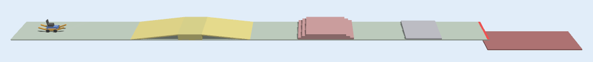
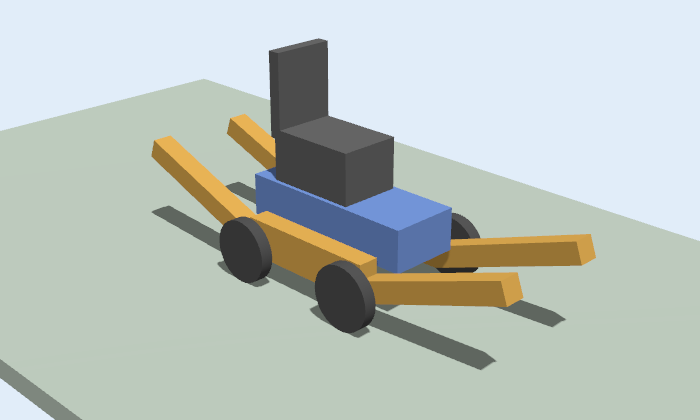

# mana_sim

The Gazebo test route, the wheel-and-track test host and its sensors. The chair follows the core's
`DriveRequest` and publishes a camera, a 3D camera, a lidar, an IMU, a GPS and wheel encoders on ROS 2
([docs/topics.md](docs/topics.md)), and `set_fault` switches sensor faults during a run
([docs/faults.md](docs/faults.md)). The ten scenarios and the CI smoke test come next.

## Run it

Needs Ubuntu 24.04 with ROS 2 Jazzy and Gazebo Harmonic (`bash tools/setup_ubuntu.sh`).

```bash
source /opt/ros/jazzy/setup.bash
colcon build --packages-select mana_msgs mana_sim
source install/setup.bash
ros2 launch mana_sim world.launch.py                  # with the Gazebo window
ros2 launch mana_sim world.launch.py headless:=true   # no window
ros2 launch mana_sim world.launch.py driver:=true     # a driver steers (see below)
```

The launch file sets the model path, starts Gazebo, bridges the chair's topics to ROS 2
(`config/bridge.yaml`) and starts the host node, `sensors_node` (transforms, `odom`, and the `motion`,
`position` and `obstacle` reports), `fault_node` (the faults, and the `link` report) and `depth_node` (the `ground` reports from the 3D camera). It
also unpauses the simulation, because the window sometimes starts paused. The scripted perception
stub is off; `stub:=true` starts it as well. `sensors:=false` leaves out the cameras and the lidar
(for a machine with no GPU).

Drive the chair by hand (the request must repeat: the chair stops 0.5 s after the last one):

```bash
ros2 topic pub -r 10 /drive_request mana_msgs/msg/DriveRequest \
  "{mode: 0, stop: false, speed_limit: 0.5, reason: test}"      # wheels, half speed
ros2 topic pub -r 10 /drive_request mana_msgs/msg/DriveRequest \
  "{mode: 1, stop: false, speed_limit: 0.3, reason: test}"      # tracks, 30 percent
```

To drive it with the decision core instead, start
`ros2 run mana_core core_node --ros-args -p use_sim_time:=true` in another terminal. The host node runs
on the simulation clock (`use_sim_time`), so the 2.5 s slide switch and the 0.5 s watchdog count
simulation seconds, also when Gazebo runs slower than real time. The core must use the same clock.

### Steering, with a driver

With `driver:=true` the host also follows `cmd_vel` (`geometry_msgs/Twist`: `linear.x` forward in
m/s, `angular.z` turn in rad/s, positive to the left) from whoever drives: the supervisor's keyboard
(#77) or the autopilot (#78). MANA's drive request still decides, whoever drives:

- the mode is always the drive request's, and nothing moves while the slides change;
- forward is capped at `speed_limit` times 1.2 m/s, turning at 1.0 rad/s and reversing at 0.3 m/s;
- after a stop, the driver can only turn on the spot or reverse, to move away from what stopped the
  chair (docs/decisions.md, D3);
- if the driver goes quiet for 0.5 s (keys let go), the chair stands still. It never drives on by
  itself in this mode.

Without `driver:=true` the chair drives straight at the speed limit, as the scripted scenarios need.

### The supervisor's keyboard: taking over from the autopilot

`driver:=true` also starts `driver_select`, which passes on the command of whoever drives: the
autopilot (`cmd_vel/autopilot`, #78) or the supervisor (`cmd_vel/supervisor`). It publishes who
drives on `driver` (`std_msgs/String`). Taking the controls is a latch: once the supervisor drives,
the autopilot is ignored until the supervisor hands back. A driver that goes quiet for 0.5 s gives
no motion; the chair never falls back to the other driver by itself.

Run the keyboard in a terminal of its own:

```bash
ros2 run mana_sim keyboard --ros-args -p use_sim_time:=true
```

| Key | What it does |
|---|---|
| arrows | up and down change the speed by 0.1 m/s, left and right the turn by 0.2 rad/s; the first one takes the controls |
| `x` | stand still, keeping the controls |
| `h` | hand the controls back to the autopilot |
| space | STOP to the core (and the supervisor's own motion to 0) |
| `g` | GO |
| `y` / `n` | YES / NO, to answer MANA's question about stairs down |
| `m` / `a` | MANUAL / AUTOMATIC |
| `w` / `t` | WHEELS / TRACKS |
| `+` / `-` | speed up / slow down |
| `q` | quit |

Taking the controls does **not** put the core in manual mode. In manual mode the core leaves the
mode and the speed to the user, and skips its own change to tracks and its slow-downs, which is
what a test drive is meant to show. `m` and `a` stay available as the user's own commands.

```bash
ros2 topic pub -r 10 /cmd_vel geometry_msgs/msg/Twist \
  "{linear: {x: 0.5}, angular: {z: 0.4}}"                       # forward 0.5 m/s, turning left
```

## Smoke test

`tools/sim_smoke.sh` starts the world headless with no cameras and no lidar (`sensors:=false`, for a machine
with no GPU), starts the core, and passes when a `DriveRequest` and a `UserMessage` are published within 90 s.
`--no-core` runs it without the core and must fail. In CI the workflow `.github/workflows/sim-smoke.yml` runs
both, when the simulation, the core or the script change and every night. Locally, after
`colcon build` and `source install/setup.bash`:

```bash
tools/sim_smoke.sh               # passes in a few seconds
tools/sim_smoke.sh --no-core     # fails after the time limit
```

## The route

One straight course along +x, 3 m wide. The chair starts at x = 1 m.



| x (m) | What | What the core should do |
|---|---|---|
| -2 to 8 | level ground | wheels, full speed |
| 8 to 12 | ramp up, 0.5 m rise (7 degrees) | wheels, slow |
| 12 to 14 | plateau, 0.5 m high | |
| 14 to 18 | ramp down | wheels, slow |
| 18 to 22 | level ground | |
| 22 to 22.66 | stairs up: 3 risers of 17 cm (x = 22, 22.33, 22.66) | tracks, slow |
| 22.66 to 26 | top of the stairs, 51 cm high | stay on tracks until level for 2 s |
| 26 to 26.66 | stairs down: 3 risers (x = 26, 26.33, 26.66) | stop and ask |
| 26.66 to 31 | level ground | back on wheels |
| 31 to 34 | curb, 12 cm high | tracks |
| 34 to 38 | level ground | |
| 38 to 46 | a drop of 1 m (the ground ends) | stop 0.5 m before the edge |

## The host



`mana_chair` has a chassis on two sets of undercarriage, each on a vertical slide: four driven wheels
(wheels mode) and two tracks (tracks mode). Only one set touches the ground. `host.py` turns each
drive request into four commands (the two slide positions and a speed for each set). A change of
mode stops the chair, moves the slides (2.5 s) and then drives on the new set. `host_node.py` runs
it in ROS 2, and stops the chair when no request has arrived for `watchdog_s` (0.5 s).

| Topic | Type | Meaning |
|---|---|---|
| `drive_request` | `mana_msgs/DriveRequest` | what the host follows (mode, stop, speed_limit) |
| `/model/mana_chair/ground_truth` | `nav_msgs/Odometry` | where the chair really is |

Speed is `speed_limit` times 1.2 m/s, the same top speed as the scripted world. With a driver it
is the driver's speed, capped there.

## Known limits

- The tracks climb the 17 cm steps (the step height of the scripted world), the ramps and the curb at
  up to 0.5 m/s. Faster, they have not been tried on the stairs.
- Without a driver the chair drives straight; steering needs `driver:=true` and `cmd_vel`.
- On wheels the chair turns at about 60 percent of the asked turn rate (0.8 rad/s for 2 s gave
  about 55 degrees, not 92): four wheels steered as two sides skid. The tracks turn at about the
  asked rate. A driver corrects for it by steering; the autopilot (#78) closes the loop itself.
- The route is 3 m wide with nothing beyond its sides: steer far off the centre line and the chair
  falls off. Free driving needs the open test world (#79).
- Turning on the spot after a stop swings the ends of the chair: on tracks the front is 1.1 m from the
  centre (below), so near a drop the turn itself can bring an end over the edge. Nothing behind the
  chair is sensed, which is why reversing is slow.
- The slides are open loop: both sets move at once for the 2.5 s of a mode change, so for a moment
  neither fully carries the chassis, and the host does not check that the slides have arrived.
- The tracks (belt and sloping ends) are about 2.2 m long, against a 0.9 m chassis: the front of the
  chair is 1.1 m from its centre. Take that into account when a scenario measures the distance to an edge.
- A drive request with a mode other than 0 or 1 is ignored (the chair stands still) and logged.
- The cameras and the lidar need the rendering engine. In a window or headless
  (`--headless-rendering`) they run on the CPU in WSL, so the real-time factor drops a little.
- The simulated GPS gives no covariance, so the error in `position` is the fixed 1.5 m.
- The lidar is a single plane 63 cm above the ground: it does not see the curb, a low step or a drop.

## Tests

`colcon test --packages-select mana_sim` runs `test/test_host.py` (the mode switch, the speeds, the
stop, and a driver's steering capped by the drive request), `test/test_driver.py` (who drives, and
the keys), `test/test_sensors.py` (the sensor maths, and that the frames in the code are the ones in
the model) and `test/test_faults.py` (the faults and their scenarios) without Gazebo, and
`test/test_driver_select_node.py` in ROS 2. With the simulation running,
`tools/check_topic_rates.sh` checks that every sensor publishes at the rate in
[docs/topics.md](docs/topics.md).
